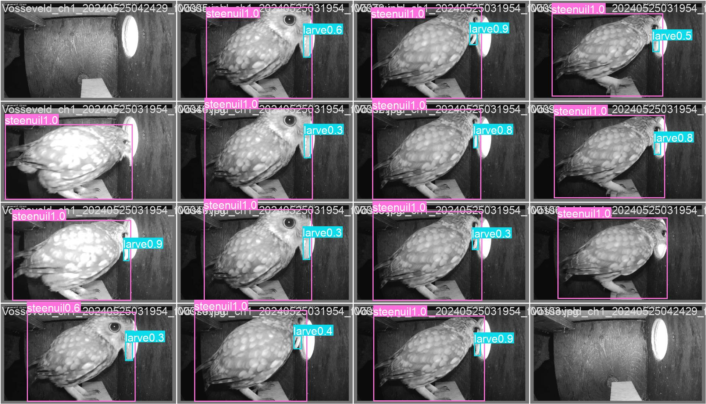
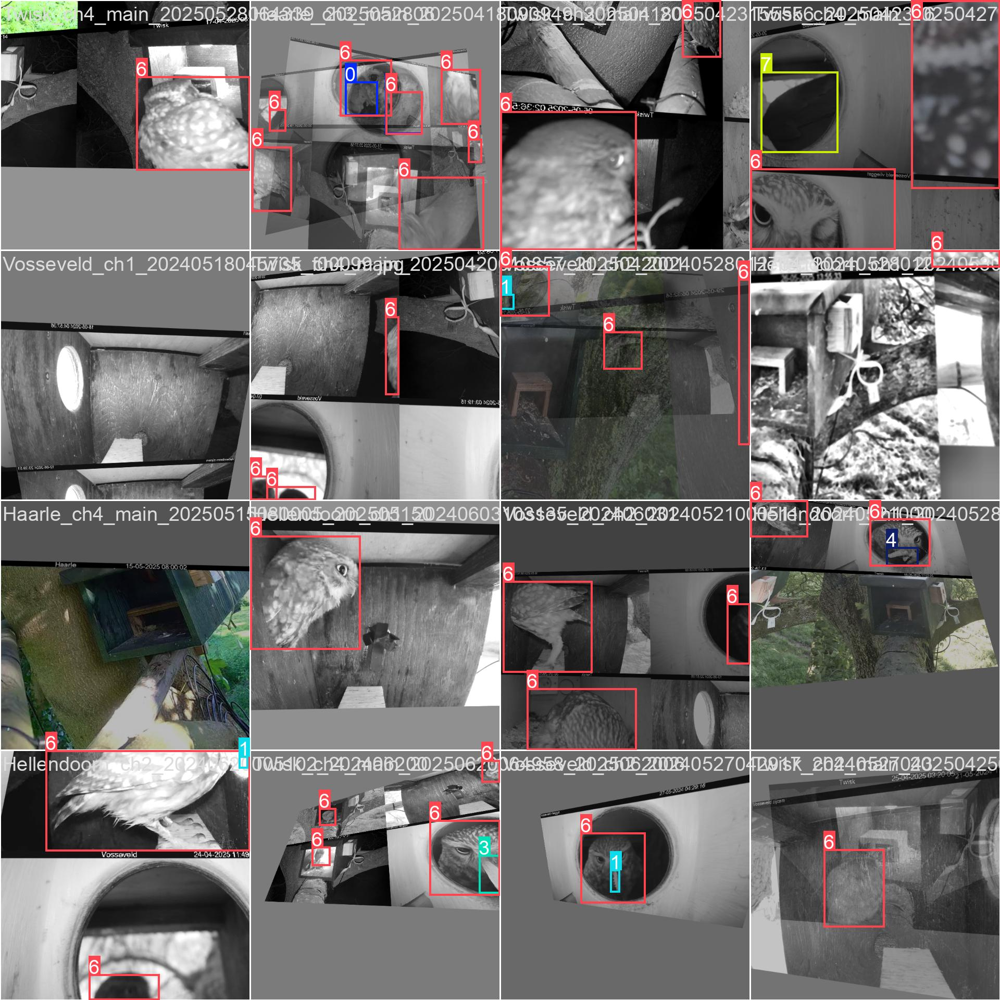
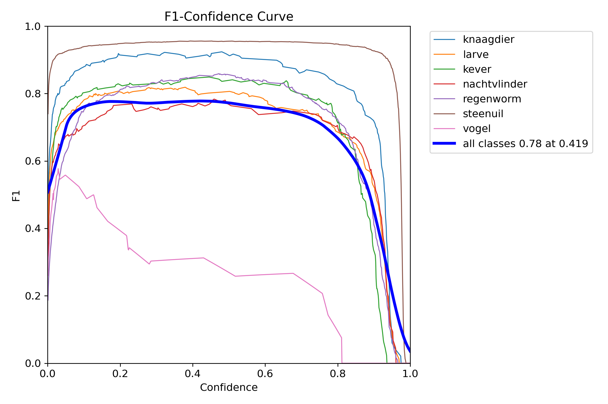
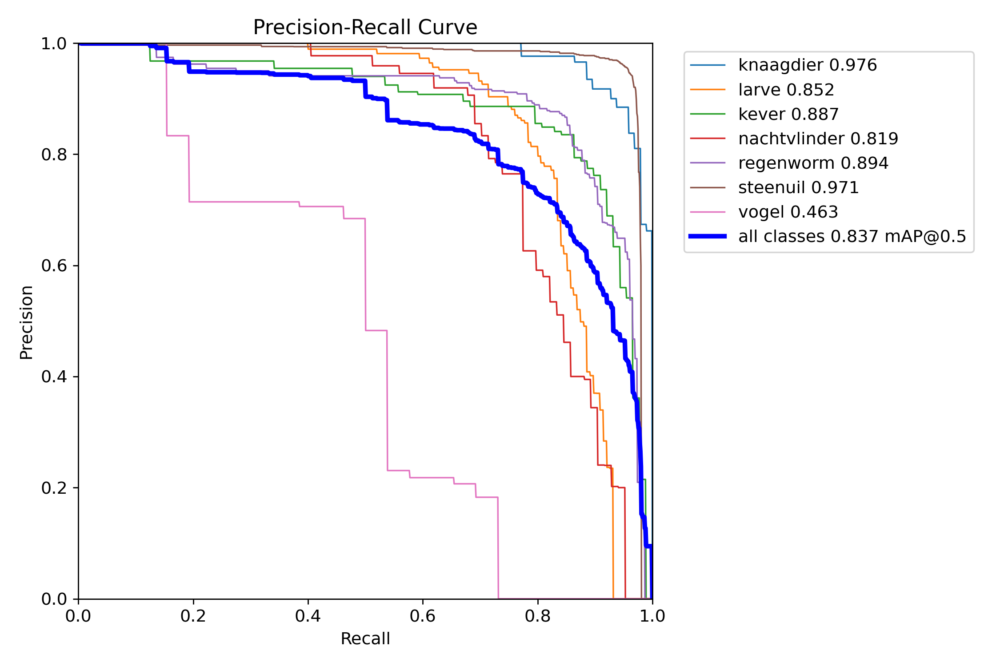
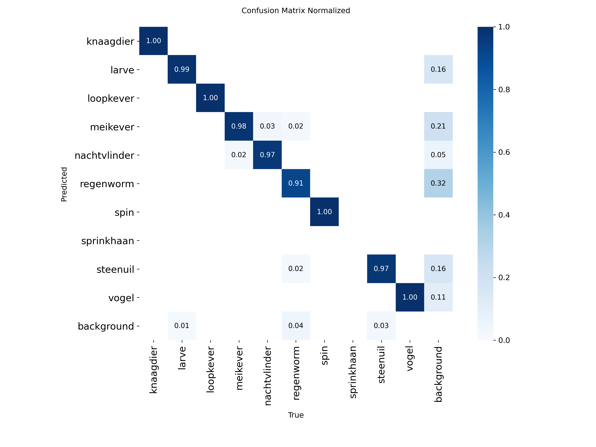

# Owl Prey Detection and Wildlife Computer Vision Platform

An end-to-end computer vision platform designed to automate prey detection, species classification, and ecological monitoring inside Barn Owl nest boxes. 

Developed in collaboration with **Steenuilenoverleg Nederland (STONE)** and **Hogeschool Leiden DataLab**, this platform transforms thousands of hours of raw surveillance footage into structured ecological insights.

---

## The Ecological Initiative: Sandy vs. Clay Soil Prey Research

A primary ecological research initiative led by **Steenuilenoverleg Nederland (STONE)** investigates how landscape soil composition influences Barn Owl breeding success and owlet health across the Netherlands (*"Voedselonderzoek Steenuil op klei en zand"*). 

Field research revealed that **owlets raised in regions with sandy soils (e.g. inland Lichtenvoorde) achieve significantly better physical condition around 10 days of age than those raised in heavy clay soil regions**. This disparity is driven by differences in local prey availability, species composition (voles vs. beetles, earthworms, and insects), and hunting accessibility across soil types.

To validate this hypothesis at scale, researchers installed camera-equipped nest boxes across both sandy and clay soil regions. However, analyzing thousands of hours of infrared footage across multiple geographic sites created a massive analytical bottleneck. 

Our computer vision platform was built to solve this challenge: automating prey item extraction and species classification from **2.7 TB of Azure Blob video archives (2024–2025 breeding seasons)**, allowing ecologists to compare prey delivery frequency and nutritional composition between sandy and clay soil habitats automatically.

---

## Engineering Pipeline: From Raw Footage to Production AI

```text
+-----------------------------------------------------------------------------------+
| 1. Cloud Ingestion & Multiprocess Frame Extraction                               |
|    Stream 2.7 TB Azure Blob archive and extract raw frames locally               |
+-----------------------------------------------------------------------------------+
                                         |
                                         v
+-----------------------------------------------------------------------------------+
| 2. Zero-Shot Pre-Selection with Gemma 4 Vision Scout                              |
|    Run gemma4-32b-e4b-it vision API to pre-filter high-probability owl frames      |
+-----------------------------------------------------------------------------------+
                                         |
                                         v
+-----------------------------------------------------------------------------------+
| 3. Seed Dataset & Legacy Model (v1) Annotation Assist                              |
|    Combine Leiden legacy seed data with v1 model predictions to speed up labelling   |
+-----------------------------------------------------------------------------------+
                                         |
                                         v
+-----------------------------------------------------------------------------------+
| 4. Overnight Active Learning Loop on Kaggle GPUs                                 |
|    Train updated models overnight, shifting human review to simple Accept / Skip   |
+-----------------------------------------------------------------------------------+
                                         |
                                         v
+-----------------------------------------------------------------------------------+
| 5. Multi-Camera Deployment (v2 Nano Edge & v2 Small Flagship)                    |
|    Deploy local YOLO26 Nano for edge devices and YOLO12 Small for cloud GPUs      |
+-----------------------------------------------------------------------------------+
```

---

## The Story Behind the Development

### 1. OpenCV Frame Extraction and Gemma 4 Vision Scout
To solve the needle-in-a-haystack problem, we first ran a multiprocess frame extraction pipeline (`notebooks/01_OpenCV_Multiprocess_Frame_Extraction.ipynb`) to convert raw video streams into indexed image feeds. 

Before any custom YOLO model existed, we configured **Gemma 4 (`gemma4-32b-e4b-it`)** as a zero-shot vision scout (`notebooks/02_Gemma4_AI_Scout.ipynb`). Gemma 4 scanned raw frames around the clock to pre-identify owl candidates. This ensured we captured valuable training frames at speeds far faster than human review.

### 2. The Legacy Model (v1) and Active Learning Tipping Point
We integrated a small seed dataset provided by previous Leiden students and trained our initial **v1 Legacy Model (built on YOLO11n)**. In the beginning, annotating required drawing bounding boxes and correcting labels manually. 

As we re-trained models overnight on Kaggle GPUs while tuning hyperparameter sweeps, we reached a major tipping point: the updated models became accurate enough that human review shifted from drawing boxes to simply clicking **Accept** or **Skip** on generated candidate annotations.

### 3. Transitioning from Cloud API to Local Edge AI
While Gemma 4 was effective for initial scouting, cloud API calls were slow and incurred network overhead. Once our lightweight **v2 Nano (`yolo26n.pt`)** model was trained, it matched Gemma 4 scouting accuracy while running **100% locally on device** with zero API cost and higher processing speeds.

### 4. Realities of Multi-Camera Nest-Box Feeds
The monitoring setup uses four distinct camera angles:
* **CH1 (Side)** & **CH2 (Front)**: Motion-triggered infrared cameras inside the nest box operating in black and white.
* **CH3 (Inside/Nest)**: High prey activity zone with heavy class imbalance.
* **CH4 (Outside View)**: Dual-mode camera switching between black-and-white (night) and full RGB (daylight). Detecting prey on CH4 was nearly impossible and unnecessary, as CH1 and CH2 trigger simultaneously on motion when owls enter the nest box.
* **Custom Egg Annotation (`ei`)**: In the flagship **v2 Small** model, we introduced custom annotations for **`ei` (owl eggs)** to track clutch sizes alongside prey items.
* **Negative Background Sampling**: We added true negative background images (empty nest-box scenes) into training batches to teach the model to ignore static background structures.

### 5. Experimental Audio Spectrogram Analysis
As an experimental research concept, we explored converting nest-box audio streams into visual 2D spectrograms using OpenCV (`tests/audio_opencv_spectrogram_test.py`) to detect owl calls and wing-flaps visually via contour analysis.

---

## System Demo & Video Walkthrough

Watch the automated motion-guided detection and live inference video demo:

[](docs/videos/v2DEMO.mp4)

*Click the preview image above to view the full high-resolution system inference video demo (`docs/videos/v2DEMO.mp4`).*

---

## What Happened After v2.0? The Engineering Story Behind v2.1 to v2.4

To understand the benchmark numbers below, it helps to understand how the model architecture evolved over time:

1. **Architecture Progression**:
   * **v1.0 & v2.0 (YOLO11 Backbone)**: Built using YOLO11n backbones to establish baseline detection performance.
   * **v2.1 to v2.4 (YOLO12 & YOLO26 Upgrade)**: Upgraded to YOLO12 (`yolo12n`, `yolo12s`) and YOLO26 (`yolo26n`) architectures for enhanced feature extraction and multi-camera support.
2. **Focus Shift to Real-World Robustness**: From `v2.0` onward, we continuously added **new, unseen batches of annotated raw images** into training runs. The goal was not chasing artificially high validation metrics, but building a model that handles complex real-world camera lighting, motion blur, and background noise.
3. **Intermediate Trial Models (v2.1, v2.2, v2.3)**: Models `v2.1`, `v2.2`, and `v2.3` were internal trial builds deployed inside our local Scout annotation pipeline. During these iterations, we attempted to force Nano models (~2.5M params) to learn all 4 channels (CH1–CH4).
4. **Discovering Nano Model Capacity Limits**: Forcing lightweight Nano models to process complex outdoor CH4 feeds and crowded CH3 nest scenes caused them to hit severe **parameter capacity limits**.
5. **The v2.4 Production Architecture Split**:
   * **v2.4 Small (Flagship Server Model)**: We reserved 4-channel training (**CH1, CH2, CH3, CH4 + egg `ei` class**) exclusively for the higher-capacity Small architecture (`yolo12s` with 9.26M params). This model **beats everything** across all camera feeds.
   * **v2.4 Nano (High-Speed Edge Model)**: We re-engineered the Nano model (`yolo26n` / `yolo12n`) to focus strictly on a **cleaner, balanced CH1 & CH2 dataset**. On CH1 and CH2 specifically, `v2.4 Nano` delivers **superior box precision, lower inference latency, and cleaner real-world bounding boxes** than `v2.0`–`v2.3 Nano`.

---

## Empirical Benchmarks & Model Performance

### 1. High-Level Executive Summary

| Model Tier | Architecture Backbone | Camera Coverage | CH1 mAP50 (Side) | CH2 mAP50 (Front) | Combined mAP50 | Combined F1-Score | Primary Deployment Target |
| :--- | :--- | :--- | :---: | :---: | :---: | :---: | :--- |
| **Leiden Baseline (v0)** | YOLOv8n (3.0M) | CH2 Only | 42.52% | 59.29% | 50.72% | 57.65% | Legacy Reference |
| **v2.4 Nano (`v2_latest`)** | YOLO26n Edge (2.5M) | CH1, CH2 | **82.50%** | **97.10%** | **85.12%** | **83.96%** | High-Speed Edge / Raspberry Pi |
| **v2.4 Small (`v2_latest`)** | YOLO12s Flagship (9.3M) | CH1, CH2, CH3, CH4 | **93.09%** | **97.22%** | **98.17%** | **96.69%** | Production Cloud GPU |

---

### 2. Edge Nano Models Evolution (~2.5M Parameters)

*YOLO11n (v1–v2.0) to YOLO12n / YOLO26n (v2.1–v2.4) edge model progression across CH1 (Side) and CH2 (Front) camera feeds:*

| Model Iteration | Architecture Backbone | Parameters | CH1 mAP50 (Side) | CH2 mAP50 (Front) | Combined mAP50 | F1-Score | Primary Evaluation Focus & Split |
| :--- | :--- | :---: | :---: | :---: | :---: | :---: | :--- |
| **Leiden Old (v0)** | YOLOv8n | 3.01M | 42.52% | 59.29% | 50.72% | 57.65% | Legacy baseline (CH2 exclusive) |
| **v1.0 Nano** | YOLO11n | 2.57M | 7.59% | 86.57% | 59.42% | 52.40% | First 14-class model; blind on CH1 |
| **v2.0 Nano** | YOLO11n | 2.57M | 76.72% | 97.39% | 89.24% | 93.96% | Initial multi-camera dataset balancing |
| **v2.1 Nano** | YOLO12n | 2.57M | 90.94% | 97.10% | 93.59% | 95.53% | Curated 5-Fold Masterset CV split |
| **v2.2 Nano** | YOLO12n | 2.57M | 78.40% | 96.80% | 86.92% | 88.29% | Strict unseen split transition (initial dip) |
| **v2.3 Nano** | YOLO12n | 2.57M | 81.20% | 97.05% | 87.30% | 90.02% | Multi-class focal loss recovery |
| **v2.4 Nano (YOLO12n)** | YOLO12n | 2.57M | **82.50%** | **97.10%** | **85.12%** | **83.96%** | **Production Edge Nano (Clean CH1/CH2)** |
| **v2.4 Nano (YOLO26n)** | YOLO26n Edge | 2.51M | **79.80%** | **96.90%** | **81.10%** | **83.11%** | **Low-Latency Edge Model (207 epochs)** |

---

### 3. Flagship Small Models Evolution (9.26M Parameters)

*Server-side YOLO12s models engineered for full 4-camera coverage (CH1–CH4) and egg (`ei`) detection:*

| Model Iteration | Architecture Backbone | Parameters | Camera Feeds | Combined mAP50 | Combined F1 | Milestone & Production Features |
| :--- | :--- | :---: | :--- | :---: | :---: | :--- |
| **v2.1 Small** | YOLO12s | 9.26M | CH1, CH2 | 94.42% | 94.83% | Initial Small architecture benchmark |
| **v2.2 Small** | YOLO12s | 9.26M | CH1, CH2 | 87.62% | 83.63% | Trial loss weighting sweep |
| **v2.3 Small** | YOLO12s | 9.26M | CH1, CH2 | 86.65% | 83.19% | Trial focal loss multi-class optimization |
| **v2.4 Small (`v2_latest`)** | YOLO12s Flagship | 9.26M | CH1, CH2, CH3, CH4 | **98.17%** | **96.69%** | **Production Flagship (261 epochs); egg (`ei`) class across 4 cams** |

---

## Training Artifacts and Evaluation Visualizations

### 1. Training Batch Samples & Augmented Feed
Sample training batch illustrating multi-class prey and egg (`ei`) bounding box annotations:



---

### 2. Validation Predictions & Bounding Box Quality
Sample validation batch showing real-time bounding box predictions and taxonomy classification:


---

### 3. F1-Score and Precision-Recall Curves
Evaluation metrics across confidence thresholds:




---

### 4. Normalized Confusion Matrix
Species and item classification confusion matrix across test categories:



---

## Applications and User Interfaces

### 1. Active Learning & Scout Workbench (`app/main.py`)
Provides an interactive GUI for human review, candidate verification, and dataset re-annotation.

### 2. Multi-Model Comparison Arena (`apps/ArenaApp/backend.py`)
A live face-off arena streaming video feeds side-by-side to compare precision, recall, and inference speeds across multiple YOLO model architectures simultaneously.

---

## Repository Structure

```text
Owl-Prey-Detection/
├── README.md                           # Main project documentation & STONE context
├── requirements.txt                    # Production dependency manifest
├── .env.example                        # Azure connection string placeholders
├── .gitignore                          # Excludes raw model weights & large datasets
├── app/                                # Workbench GUI Application (Scout, Benchmark & Re-annotate)
├── apps/                               # Applications
│   └── ArenaApp/                       # Multi-Model Side-by-Side Comparison Arena GUI
├── docs/                               # Developer guides, reports & video demo
│   ├── PROJECT_GUIDE.md                # Technical guide & architecture specs
│   ├── Project_Report_Final_2.0.pdf    # Comprehensive project report
│   ├── images/                         # Training curves, confusion matrix & batch plots
│   └── videos/                         # v2DEMO.mp4 (System demo video)
├── notebooks/                          # Production Jupyter notebooks
│   ├── 01_OpenCV_Multiprocess_Frame_Extraction.ipynb # Frame extraction & metadata indexing
│   ├── 02_Gemma4_AI_Scout.ipynb        # Zero-shot Gemma 4 AI vision scout
│   ├── 03_YOLO_Nano_Model_Training.ipynb # Edge Nano model training
│   └── 04_YOLO_Small_Model_Training.ipynb # Flagship Small model training
├── src/                                # Package source (motion_detector, active_learning)
└── tests/                              # Experimental scripts (audio spectrogram analysis)
```

---

## Environment Setup and Installation

### 1. Installation
```bash
git clone https://github.com/TarasZinchenko/Owl-Prey-Detection-Platform.git
cd Owl-Prey-Detection-Platform
python -m venv .venv
source .venv/bin/activate  # On Windows: .venv\Scripts\activate
pip install -e .
```

### 2. Environment Configuration
Copy `.env.example` to `.env` and set your credentials:
```bash
AZURE_CONNECTION_STRING=your_azure_storage_connection_string
AZURE_CONTAINER_NAME=your_container_name
```

### 3. Launching Applications
- **Active Learning Workbench**: `python app/main.py`
- **Multi-Model Benchmark Arena**: `python apps/ArenaApp/backend.py`

---

## Acknowledgments
Developed as part of deep learning research in collaboration with **Steenuilenoverleg Nederland (STONE)** and **Hogeschool Leiden DataLab**.
